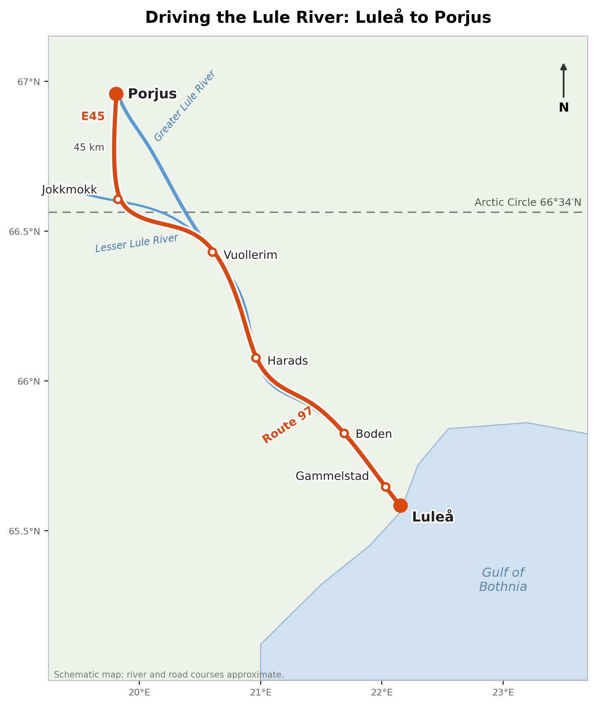
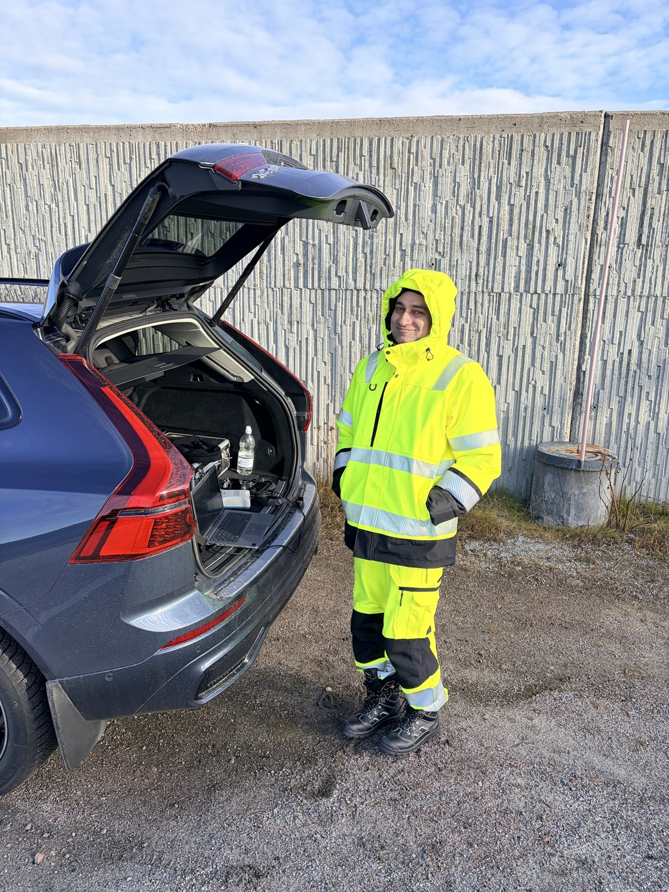
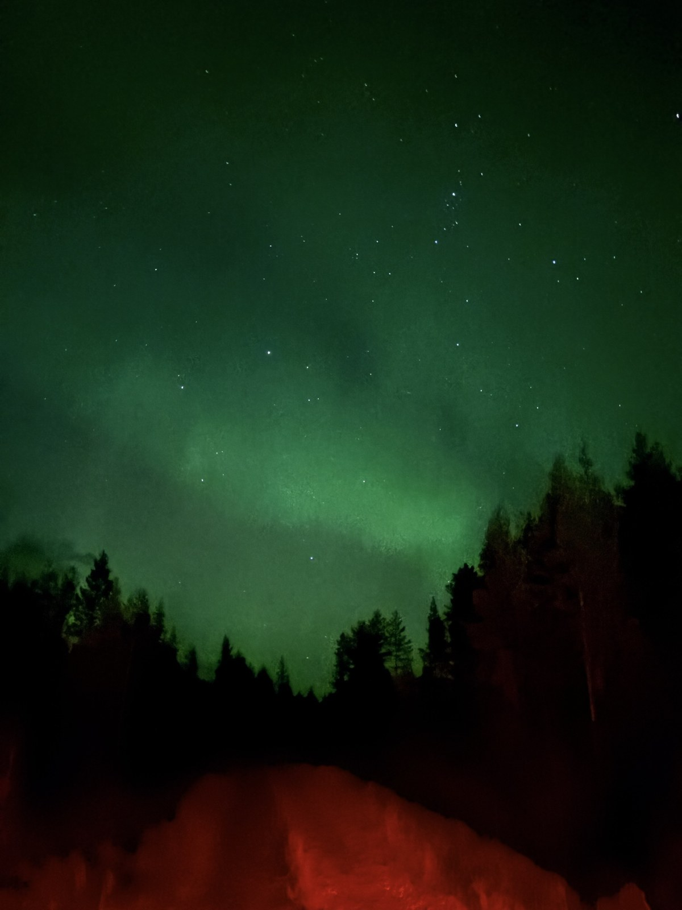

Title: From Luleå to Porjus
Date: 2026-10-03
Summary: A drive inland along the Lule River, from the coast at Luleå across the Arctic Circle to Porjus.
Cover: images/lule-arctic-circle.jpeg

The journey began aboard an SAS flight heading north. Once I had settled into my seat, I noticed a small sign on the partition just behind me: *Economy class starts here.* Not exactly the kind of label I appreciate being reminded of.

I drove the first leg myself, a Volvo XC60 from the airport into Luleå centrum. For the long stretch inland, Sam Johansson took the wheel and I took the passenger seat.

Route 97 heads west out of Luleå, past the turn-off for the church town of Gammelstad, and within an hour the city thins out into forest with the river alongside. Then comes Boden, a garrison town that does not hide it: military vehicles on the road, workshops and depots along the verge.

The road follows the valley up toward Jokkmokk, past the Treehotel in Harads, and at Vuollerim the river splits into the Greater and Lesser Lule.

<video controls playsinline muted preload="metadata" poster="../../images/lule-river-clip-poster.jpeg" style="display:block;width:100%;max-width:560px;margin:12px auto;border-radius:6px;">
  <source src="../../images/lule-river-clip.mp4" type="video/mp4">
</video>

Hours on a road like this are rarely wasted with someone who knows the country. Sam talked about Swedish culture and his own life here, then about the dams we were going to study, company culture and how one settles into a new one, and a proposal we had both been thinking about. We stopped at a roadside place advertising the best burger between Gällivare and Jokkmokk, a claim with little competition on a road this empty.

The Arctic Circle crossing is 14 km south of Jokkmokk. No border post, just a sign and a line on the map, but hard not to notice.

My own turn came later, at night: from Hotell Åkerlund out to Laponia Ställplats and on towards Porjus, through a darkness nothing like city darkness, with the aurora overhead and green light moving over the trees.

From Jokkmokk it is another 45 km to Porjus, which feels like the end of something.

A day on this road teaches you something a map cannot: how the river, the forest and the work along them belong together. For anyone planning the same trip, keep an eye on the verges, as moose are often spotted right along the road up here.

