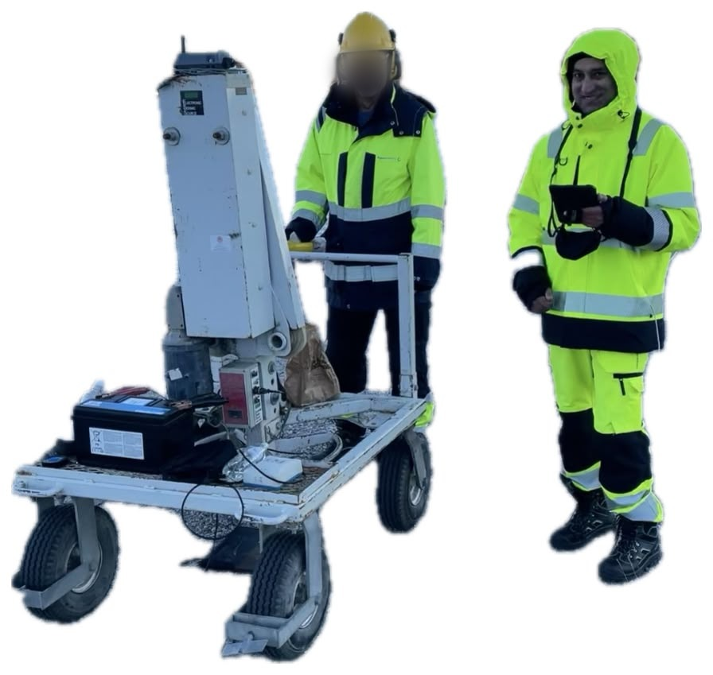

Title: HydroResearch and Silixa: The Next Generation of Collaboration
Date: 2026-10-11
Summary: A partnership that began when fibre-optic sensing in embankment dams was still experimental has now been handed to the engineers who will carry it forward.
Cover: images/collab-team-cover.jpeg

The collaboration between HydroResearch and Silixa began when distributed fibre-optic sensing in embankment dams was still experimental. HydroResearch's founder was among the first to install optical fibre in Swedish embankments and measure temperature along its length to locate seepage, work that ran through the 1990s and into a long sequence of field studies. Silixa's founder was developing the interrogation hardware that made those measurements possible at engineering precision, and went on to build the company around it in the United Kingdom. The two met, each had what the other needed, and they began working together.

What followed was several decades of measurement campaigns on operating dams, instruments tested in conditions no laboratory reproduces, interpretations revised, and methods taken back into the field and tried again. Distributed temperature sensing (DTS) became a dependable seepage indicator: seepage carries a thermal signal, and the seasonal variation measured along a cable in the dam reveals where water is moving through the fill. Distributed strain sensing (DSS) followed, resolving deformation continuously along the embankment where piezometers and inclinometers could only sample at points. More recently, distributed acoustic sensing (DAS) has made the embankment accessible to seismic methods. The same cable now records surface waves, ambient noise and temperature, so a dam can be imaged rather than only instrumented.

Two things have changed recently. HydroResearch's founder has retired, and Silixa has become part of Luna Innovations. Both could have narrowed the collaboration. Instead both have widened it: the sensing side now sits within a larger technology group, and the dam side has passed to younger engineers at HydroResearch.

Our recent campaign was the first test of that transfer. Working on a Swedish embankment dam with colleagues from Silixa, we used DAS for near-surface characterisation of the structure, recording active-source surface-wave data on permanently installed fibre while the same cable continued logging ambient noise. The two datasets are complementary: MASW gives high-frequency detail in the upper part of the embankment at the time of the survey, while the ambient noise record provides a baseline against which later surveys can be compared. Our founder joined the campaign as an advisor rather than to direct the work, which is a contribution of its own. Deciding which low-velocity zone is worth pursuing, which has been seen before and explained, and which question justifies another day on the crest is not something the data answers by itself.

He also fired the final MASW shot of the campaign: he took his place at the source, pressed the trigger, and the active-source acquisition was complete.

Afterwards we saw our partners off at Arlanda. Standing in the terminal, he said that the collaboration between us had passed to the next generation, and that he was glad of it.

We are processing and discussing the campaign data now. The scope is widening beyond dams towards mining infrastructure monitoring, elsewhere in Sweden and internationally. The instruments have changed, the companies have changed, and the people have changed. The collaboration has not.

