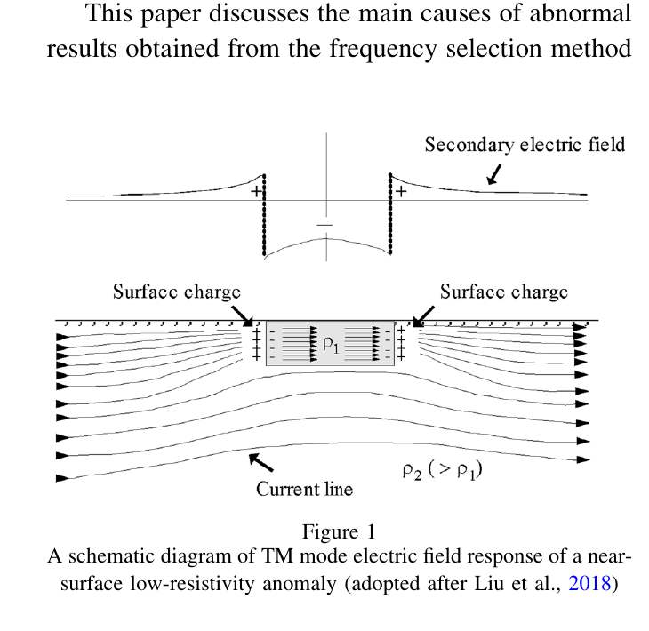
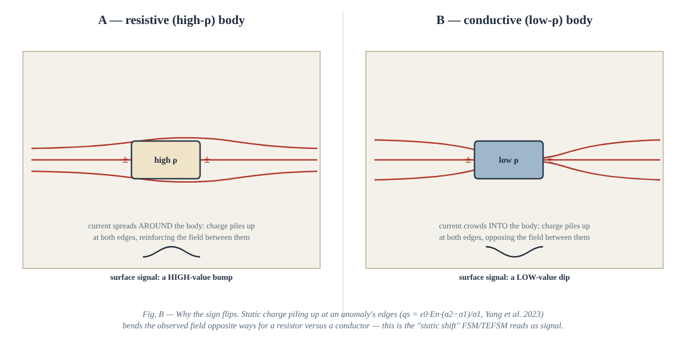
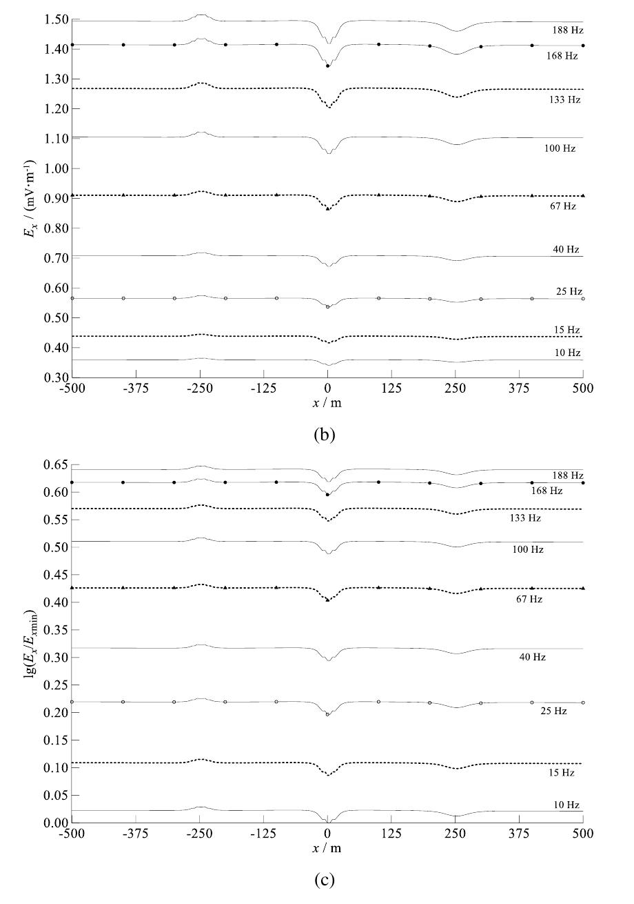
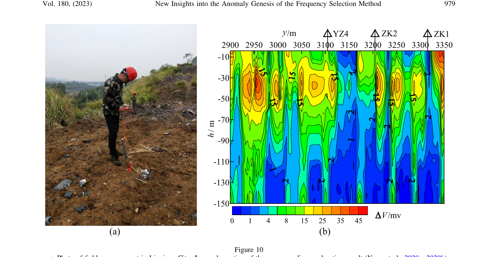
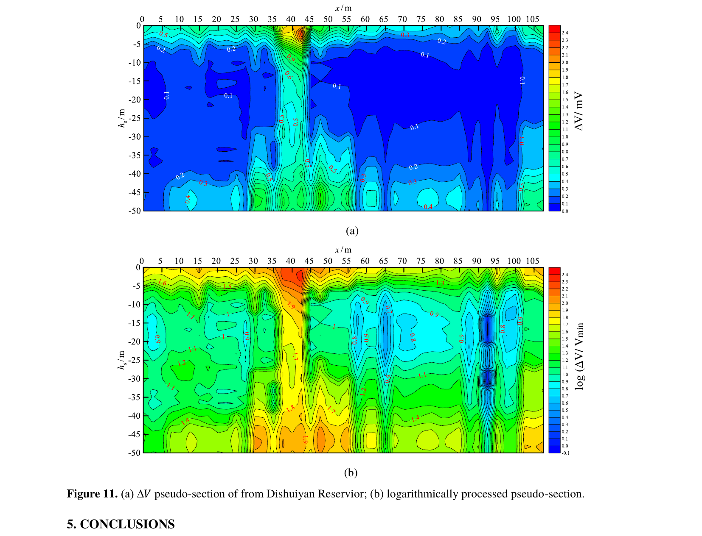

Title: The Static Shift Method: Why Frequency Selection Works, and What Is Still Unexplained
Date: 2026-10-17
Summary: For forty years, Chinese field geophysicists have used a cheap, one-component instrument to find water, caves and seepage paths, reading a signal the rest of the electromagnetic world was trained to throw away.
Cover: images/sketch-survey-setup-preview.png

Applied geophysics occasionally finds itself in an awkward position: a method that reliably finds water, caves and seepage paths, yet whose physical basis nobody has fully explained. The frequency selection method (FSM) has been in that position since the late 1970s, and although a physical explanation was put on firm ground in 2023, the work of explaining it fully is still going on.

FSM is a family of electromagnetic surveying techniques, developed almost entirely by Chinese researchers, that uses nothing but a pair of electrodes, a lightweight "frequency selector," and the Earth's own natural electrical currents. You plant two electrodes a few metres apart, read a voltage at a handful of fixed frequencies, walk the line, and look for where the profile curve shows an anomaly. Where one appears, something changes underground: a cave, a fault, a water table, a leak in a dam.

What took so long to establish was *why* the anomaly appears at all. The answer is static shift, a phenomenon electromagnetic surveyors are generally trained to regard as noise, and the details are still being worked out.

## What FSM actually is

FSM measures the horizontal electric field component ($E_x$) of the Earth's telluric currents, at a small number of selected frequencies, along a survey line. Its field setup is identical to audio-frequency magnetotellurics (AMT), and both read the same natural source: currents driven by ionospheric and solar-wind activity. The difference is what each does with the data. AMT records a broad, continuous spectrum and inverts the full electric and magnetic field relationship to build a resistivity-depth model. FSM records one field component at a few fixed frequencies and reads the anomaly directly from the profile curve, with no inversion and no broadband recording.

That is the whole appeal, and it is why FSM has thrived specifically in groundwater prospecting and mine-water hazard work, where a crew needs a fast answer rather than a full resistivity model. The modern instrument used throughout the papers this post draws from, the PQWT-TC300, weighs about 0.7–1 kg and samples 40 frequencies between 12 and 5000 Hz (Zhu *et al.*, 2026). The 1985-vintage DX-1 selector offered roughly six fixed frequencies: around 15, 72, 161, 262, 327 and 783 Hz. Neither needs a transmitter, a generator, or kilometres of cable.

## Where it came from

FSM is a lineage, not one method. A string of Chinese researchers worked largely independently from the late 1970s to the 2000s and kept arriving at variations on the same idea (Yang *et al.*, 2023):

| Year | Researcher | Contribution |
|---|---|---|
| 1976 | Liang, B.H. | Electric pulse of a natural field method, first applied to groundwater exploration |
| 1982 | **Yang, J.** | Stray current method (audio earth potential method), first to carry out theoretical research on an experimental basis |
| 1982 | Xin, Y. | Audio geoelectric field method; SDD-1 acoustic geodetic instrument |
| 1983 | Lin, J. *et al.* | Natural low-frequency electric field method, first to model the anomaly on a vertical-dike model using magnetotelluric propagation theory |
| 1985 | Han, R. & Wu, M. | Frequency selection method for the telluric electricity field; built the DX-1 instrument **explicitly by referencing the magnetotelluric instrument** |
| 1991 | Li, X. | Telluric electrical field frequency selection method |
| 1991 | Lian, K. *et al.* | Audio telluric electricity method |
| 1994 | Bao, G. *et al.* | Interfering electric field method, with indoor simulation and field trials |
| 1994 | Luo, H. | Natural alternating field method |
| 2009 | Zhou, H. *et al.* | Underground magneto-fluid detection method |

Yang (1982) gave the method its working form as the *stray current method*, grounded in experiment rather than instrument-building alone. Three years later, Han and Wu built their frequency selector by consciously borrowing from magnetotelluric instrument design, and that is where FSM's kinship with MT became explicit rather than coincidental.

## The signal everyone else was told to throw away

In magnetotelluric surveying, static shift is a known nuisance: small, shallow, electrically inhomogeneous bodies near the surface distort the observed field in a way that is independent of frequency, offsetting the whole resistivity-depth curve and corrupting the deep signal the survey is after. The standard response is to suppress it, through impedance tensor decomposition, joint inversion, or statistical correction (Yang *et al.*, 2023).

Yang, Gao, Li, Fu and Hussain (2023) suggested this reflected convention more than physics, and offered an instructive analogy: "Just as in the initial period of seismic exploration, Rayleigh waves were always treated as interference signals." Surface waves, once dismissed as unwanted energy on reflection sections, turned out to carry exactly the near-surface shear-velocity information that whole sub-disciplines were later built on.

The physical cause is straightforward once stated. When current flows through the boundary of an electrically inhomogeneous body, Gauss's law and current continuity require charge to accumulate on that interface:

$$q_s = \varepsilon_0 E_{n2}\frac{\sigma_2-\sigma_1}{\sigma_1}$$

where $\sigma_1,\sigma_2$ are the conductivities of the anomalous body and the surrounding rock, $E_n$ is the normal electric field strength at the interface, and $\varepsilon_0$ is the permittivity of free space (Yang *et al.*, 2023). That accumulated charge generates a secondary electric field with the *same phase as the primary field, independent of frequency*. That frequency independence is what makes it a static shift rather than an induction response, and right at the surface it is impossible to ignore.

*Figure 1 from Yang, Gao, Li, Fu & Hussain (2023), <em>Pure and Applied Geophysics</em> 180, 969–982: current lines bending around a near-surface low-resistivity anomaly, with charge accumulating at its edges and distorting the observed surface field directly above it.*

*Fig. B: The same mechanism, simplified. A resistive body forces current to spread around it, and the surface reads a high-value response directly above; a conductive body pulls current into it, and the surface reads a low-value response. Finite-element modelling (Yang* et al.*, 2023; Yang* et al.*, 2025) reproduces this sign reversal between high- and low-resistivity targets, though how closely the simplified model represents real, irregular bodies in the ground remains to be established.*

The contribution of Yang *et al.* (2023) is not a new instrument or a new survey. It is a finite-element study, compared against an analytic layered-medium solution and against borehole results, supporting the interpretation that the FSM anomaly originates in the same charge-accumulation effect responsible for MT static shift, read directly in the field instead of corrected away. Their conclusion proposes, on that basis, that "the FSM method can be called the 'static shift method.'" It is a well-argued proposal rather than a settled result, and it has yet to be tested outside the group that put it forward.

## Reading the anomaly: how the data gets processed

A raw FSM profile is noisy. The dynamic range of the measured potential difference (ΔV) is large, and strong shallow anomalies swamp weaker, deeper ones in the pseudo-section (Zhu *et al.*, 2026). Zhu, Yang, Hussain and Qin (2026) proposed a logarithmic normalisation applied immediately after acquisition:

$$P = \log\left(\frac{\Delta V}{\Delta V_{min}}\right)$$

where $\Delta V_{min}$ is the smallest observed value on the profile, set to 0.001 mV if the true minimum is zero. This compresses the dynamic range, suppresses the strongest anomalies and enhances the weaker ones, giving far more uniform contour spacing.

*Figure 1(b,c) from Zhu, Yang, Hussain & Qin (2026), <em>Transactions on Electromagnetic Spectrum</em> 5(2), 35–50: the same forward-modelled anomaly before (top) and after (bottom) logarithmic normalisation. The anomaly over the buried body becomes consistent and well-defined across every frequency, rather than nearly invisible at some and exaggerated at others.*

It is cheap enough to run on-instrument: "users can perform full processing with a single click; the entire operation completes within 2 seconds" (Zhu *et al.*, 2026).

## Field validation: three tests

**Three boreholes, three confirmed caves.** In a limestone mine near Linxiang City, Hunan, a TC150 selector scanning 36 frequencies flagged anomalies at three positions along a profile. Three boreholes were drilled to check them. YZ4 intersected a mud-and-clay-filled karst cave at 36.0–38.3 m. ZK2 intersected two semi-filled caves, at 22.5–31.0 m and 37.6–42.4 m. ZK1 intersected caves at 18.5–31.0 m and 34.5–40.5 m (Yang *et al.*, 2023).

*Figure 10 from Yang, Gao, Li, Fu & Hussain (2023): field measurement in Linxiang City (a), and the resulting pseudo-section (b), with three subsequent boreholes (YZ4, ZK2, ZK1) intersecting karst caves at the positions the anomalies indicated.*

**Groundwater, twice over.** In Lengshuijiang City, a quartz-sandstone site, a sharpened anomaly at 36 m led to a well that struck groundwater at 130 m depth, yielding roughly 150 t/day. In nearby Taojiang County, a Caledonian granodiorite setting, an anomaly narrowed to 131.0–134.5 m led to a well at 133 m that struck mineral water at 210 m, at roughly 450 t/day (Zhu *et al.*, 2026). An earlier survey at the same Lengshuijiang site had already produced a well at 120 m yielding 100 t/day shallow and over 300 t/day at 150 m (Yang *et al.*, 2023).

**A dam, not just a borehole.** The case closest to my own work: a seepage survey at Dishuiyan Reservoir, a small Hunan dam, using a dedicated PQ-227B dam-piping detector (450–5000 Hz, roughly 50 m depth). Several low-potential anomalies were found along the crest; after logarithmic processing, the pseudo-section pointed to severe seepage between 10 and 30 m depth at several stations, interpreted as occurring mainly near the dam body/bedrock interface (Zhu *et al.*, 2026).

*Figure 11 from Zhu, Yang, Hussain & Qin (2026): ΔV pseudo-section across the Dishuiyan Reservoir dam crest, raw (a) and logarithmically processed (b). The processed section resolves several seepage-consistent anomalies that are far harder to isolate in the raw data.*

Having spent the last several months on distributed fibre-optic and acoustic monitoring of embankment dams and tailings infrastructure, this strikes me as exactly the category of problem FSM is suited to screen: a first-pass, low-cost survey that tells you where to put the more expensive, continuous instrumentation.

**A useful false alarm.** Not every anomaly is natural. At the same Taojiang site, a strong low-potential anomaly at 18 m, with the textbook "noodles" signature, looked like a groundwater target. Ground investigation found a shallow engineered underdrain instead: a rectangular ditch roughly 0.4 m deep, 0.8 m wide and 1 m high, alongside a 0.3 m-diameter pipe (Yang *et al.*, 2023). The electrical response behaved as expected; what it meant geologically required ground investigation to settle. FSM responds to inhomogeneity, not to water specifically, and distinguishing between causes still depends on independent information.

## Where the method is open to challenge

The framing invites a reasonable objection from anyone trained in classical magnetotellurics, and it deserves a direct answer. Static shift, in the rigorous MT sense, is a frequency-independent distortion of the impedance-derived apparent-resistivity curve, defined through the ratio of electric to magnetic field. FSM never computes an impedance; it reads raw electric-field amplitude. The charge-accumulation mechanism really is the same one, but the term has a precise technical definition, and applying it to a measurement that doesn't produce the quantity it is defined on is an analogy rather than an identity. A specialist reviewer is right to ask that the bridge be made explicit.

The second challenge concerns evidence. Most published validation, including the cases above, confirms an anomaly's location *after* the fact, usually with a single borehole or a structure already suspected to be there. That is not the same as showing an anomaly moved or intensified *before* an event, which is the standard a method must clear before it is trusted for monitoring rather than prospecting.

Neither objection diminishes the three confirmed boreholes at Linxiang or the Dishuiyan results. But in a field this specialised, scrutiny from outside is what allows a method to be trusted beyond the group that developed it, which is why predictive validation, rather than further instrument development, is the more useful direction.

## What's still open

Two directions are being pursued. One asks whether the magnetic field component could do the same job as the electric field FSM has always used. Forward modelling says the horizontal magnetic field ($H_x$) is, if anything, more sensitive to shallow conductive bodies, and improves at lower frequencies (Yang *et al.*, 2025). A field test at a low-noise site in Xinjiang proved less encouraging: $H_x$ amplitude proved so small, and so easily swamped by distant interference (a solar power station several kilometres away was the leading suspect), that a workable "TMFSM" will need purpose-built, interference-resistant magnetic sensors first.

The other turns the survey into a monitor. A follow-up study I am working on with colleagues runs a multi-frequency device through a flood season at a dam site instead of walking the line once, tracking 25, 67 and 170 Hz across several piping events to see whether jumps in the static-shift anomaly match the timing of seepage surges. It is early-stage work, and the open questions are the right ones: separating a genuine seepage signal from interference at the more exposed frequencies, quantifying anomaly amplitude against actual water level or flow rather than reading anomaly amplitude qualitatively, and building the statistical case that an anomaly *precedes* a piping event.

## Why this matters more than the instrument

This is not really a story about an instrument. A field method with four decades of empirical success is being given a physical foundation, and that work started from taking seriously a signal an adjacent discipline had learned to set aside. In a survey built around a single shallow target rather than a deep resistivity model, what is normally a nuisance may be the measurement itself.

How far that interpretation holds, and under what conditions, is still an open question. The modelling is consistent with it, the field results are consistent with it, and neither amounts to proof. There is a good deal left to do, and Professor Yang's group continues to work on it.

---

### References

Yang, Gao, Li, Fu & Hussain (2023). *Pure and Applied Geophysics* 180(3), 969–982.

Yang, Zhu, Hussain, Huang, Yu & Ding (2025). *Journal of Applied Geophysics* 233, 105608.

Zhu, Yang, Hussain & Qin (2026). *Transactions on Electromagnetic Spectrum* 5(2), 35–50.

